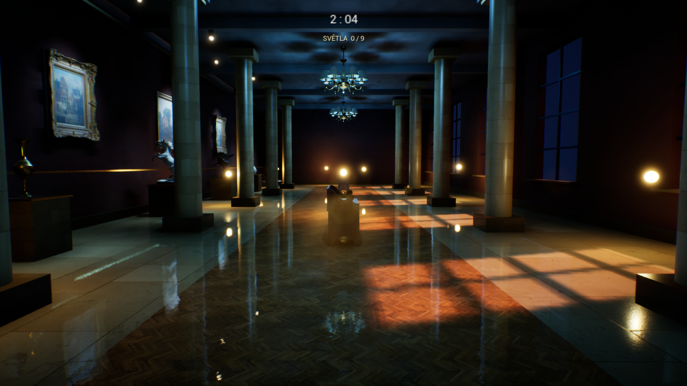
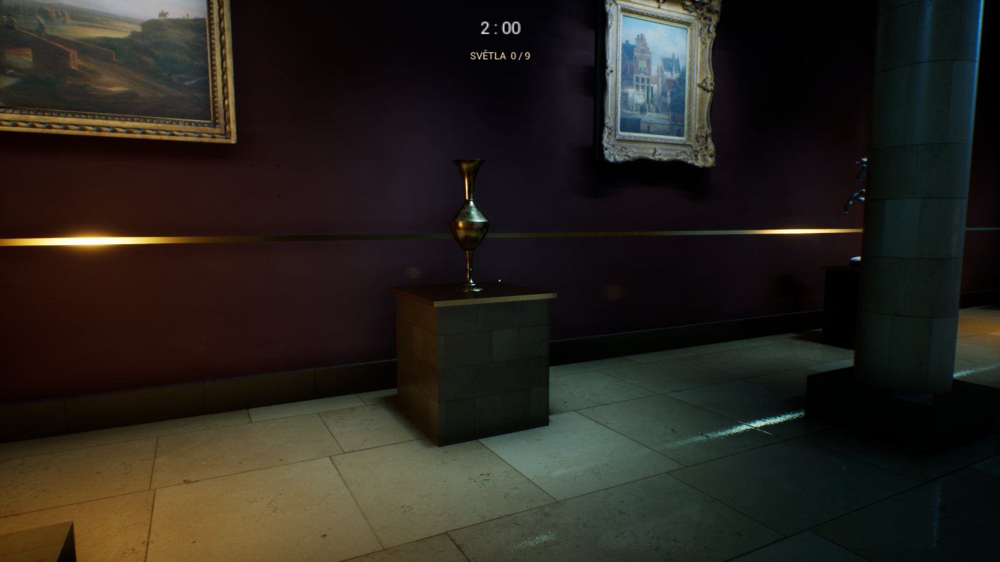
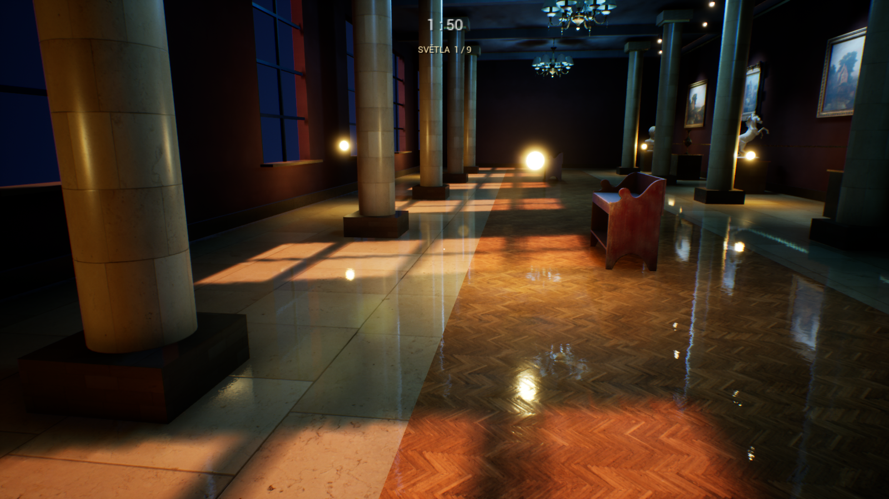

# Galerie o půlnoci

First-person hra v Unreal Engine 5.8, vytvořená za 1 hodinu.
Noční mramorová galerie za bouřky: posbírej všechna zlatá světla, než se galerie zamkne. Každé světlo „zpívá" — dá se najít po sluchu.

- **Odrazy:** leštěná mramorová podlaha (planární zrcadlení + SSR + reflection captures)
- **Zapečené světlo:** všechna světla scény jsou Static a pečou se Lightmassem do lightmap (měsíc skrz okna, reflektory nad exponáty, lustry)
- **Zvuk:** déšť, hrom po blesku, kroky po mramoru s dozvukem haly, 3D prostorový hlas světel (`Tools/make_audio.py`)
- **Assety:** PBR textury, modely a HDRI z [Poly Haven](https://polyhaven.com) (CC0)

## Spuštění
Mapa i zapečené světlo jsou už v repozitáři (`Content/`).
1. `Tools\win\build.bat` — zkompiluje C++ modul (jednou, ~30 s)
2. `HRAT.bat` — spustí hru. Při úplně prvním spuštění se pár minut kompilují shadery (povrchy jsou mezitím šedé šachovnice), pak už startuje rychle.

`SESTAVIT.bat` postaví vše od nuly (import, mapa, Lightmass bake ~15 min) — potřeba jen po změně `Tools/build_level.py`; po něm je nutné znovu zapéct světlo.

Ovládání: WASD chůze · myš rozhled · Shift běh · mezerník skok · F baterka · R znovu · Esc konec

## Výkon
Měřeno na integrované Intel grafice v 1600×900: 31–43 FPS (`Tools/playshot.sh` — hra sama vyfotí 6 pohledů do `Saved/Shots` a zapíše FPS do logu).

## Struktura
- `Source/Galerie/` — hra v C++ (hráč, světla, pravidla, HUD)
- `Tools/build_level.py` — import assetů, materiály a stavba mapy (Unreal Python)
- `Tools/make_audio.py`, `Tools/fetch_assets.py` — syntéza zvuku, stažení CC0 assetů
- `SourceAssets/` — zdrojové textury, modely, zvuky
